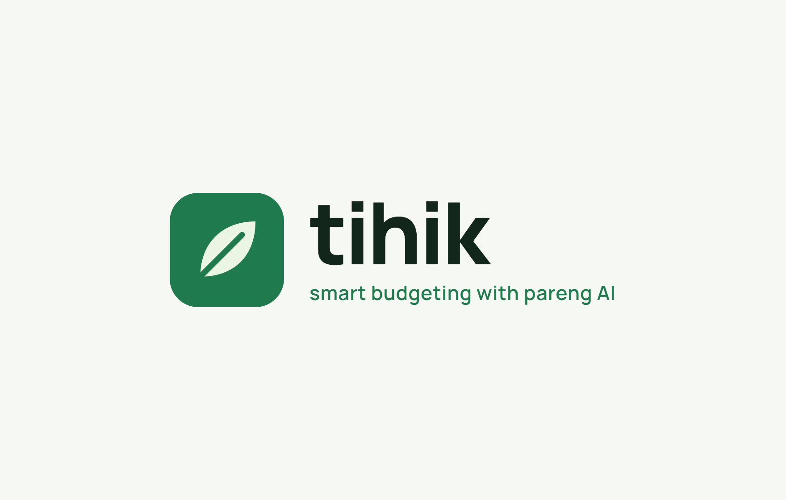

# Tihik

A budgeting bot on Facebook Messenger, with a personal web dashboard for each user. The bot talks in Bislish, mostly English mixed with Cebuano/Bisaya, and onboarding is mostly English. Claude reads messages like "jollibee 185 dayon plete 40" and turns them into entries. It also understands Tagalog and English.

## What it does

1. **First chat:** the bot greets the user by their Messenger first name (from the Messenger profile API; if Meta doesn't share it, the bot asks for a name instead) and uses it in replies, reminders and the dashboard. "call me JC" changes it anytime. Then it asks how much money they get a month ("kwarta kada bulan"): a salary for workers, an allowance for students. They can answer "25k", or "1,500 kada semana" / "200 kada adlaw" for a weekly or daily allowance (converted to a monthly amount), or type "skip" to only track spending, with no daily budget. Both questions can be skipped.
2. **Daily logging:** users chat their expenses ("lunch 150", "grocery 2,350 gahapon") or additional income ("sideline 2k", "bonus 5000"). After each entry the bot replies with what's left this month and how much they can still spend today.
3. **Dashboard:** typing "dashboard" sends a private link with:
   - how much is left to spend today
   - the month's progress
   - spending per day against the daily budget
   - spending by category
   - every entry, with previous months one tap away
4. **Daily cron (8 PM Manila):** sends one of three messages:
   - a reminder to anyone who hasn't logged today
   - a short recap to anyone who has
   - on the 1st of the month, a recap of last month

Other commands: `tips` (AI budgeting tips based on the user's own spending), `undo`, `help`, `new link` (makes a new dashboard link and turns off the old one), "30k na akong sweldo" or "6k na akong allowance" to change the monthly amount, "call me JC" to change their name, and `restart` (asks for a "yes" first) to delete their entries, name and income and start onboarding again with a new dashboard link.

**How "spendable today" is worked out:** whatever is left this month is split evenly over the days remaining, today included. Overspending today lowers tomorrow's budget, and spending less raises it.

## Project layout

```
server.js        web service: Messenger webhook, dashboard, /cron/daily
cron.js          cron service: calls /cron/daily once and exits
lib/bot.js       conversation flow (onboarding, logging, commands)
lib/ai.js        Claude call that turns a message into structured entries
lib/stats.js     budget math
lib/dashboard.js dashboard page (server-rendered HTML + SVG chart)
lib/db.js        SQLite storage (Node's built-in node:sqlite, no npm packages)
lib/messenger.js Send API + webhook signature check
```

No dependencies. Needs Node 22.13 or newer.

## Run locally

```bash
export ANTHROPIC_API_KEY=sk-ant-...
npm run dev
# chat without Facebook:
curl -s localhost:3000/dev/chat -d '{"text":"hi"}'
curl -s localhost:3000/dev/chat -d '{"text":"25k"}'
curl -s localhost:3000/dev/chat -d '{"text":"jollibee 185 dayon plete 40"}'
```

The reply after "25k" contains a `localhost:3000/d/...` link to your dashboard. `/dev/chat` is switched off when `NODE_ENV=production`.

## Deploy on Railway

Push this folder to a GitHub repo, then in Railway:

### 1. Web service
- **New Project → Deploy from GitHub repo.** Railway detects Node and runs `npm start`.
- **Add a Volume** to this service, mounted at `/data`. The SQLite database lives there, so it survives redeploys.
- **Settings → Networking → Generate Domain.** Use this as `PUBLIC_URL`.
- **Variables:**

  | Variable | Value |
  |---|---|
  | `ANTHROPIC_API_KEY` | your Claude API key |
  | `PAGE_ACCESS_TOKEN` | from the Meta app (Messenger → API settings) |
  | `APP_SECRET` | Meta app → App settings → Basic |
  | `VERIFY_TOKEN` | any secret word; you'll paste it into Meta |
  | `PUBLIC_URL` | `https://<your-domain>.up.railway.app` |
  | `CRON_SECRET` | a long random string |
  | `DB_PATH` | `/data/tihik.db` |
  | `NODE_ENV` | `production` |
  | `TZ_NAME` | `Asia/Manila` |
  | `AI_MESSAGES_PER_DAY` | optional, default `40` |
  | `TIPS_PER_DAY` | optional, default `2` |

### 2. Cron service
- In the same project: **New → GitHub Repo → the same repo** (creates a second service).
- **Settings → Deploy → Custom Start Command:** `node cron.js`
- **Settings → Cron Schedule:** `0 12 * * *` (12:00 UTC = 8:00 PM Manila).
- **Variables:** `APP_URL` = the web service's `PUBLIC_URL`, and `CRON_SECRET` = the same value as the web service.
- The cron service calls the web service over HTTP because a Railway volume can only be attached to one service.

### 3. Messenger
1. In your Meta app, under **Messenger → API settings**, set:
   - callback URL: `https://<your-domain>/webhook`
   - verify token: same as `VERIFY_TOKEN`
   - subscriptions: `messages` and `messaging_postbacks`
2. Add the Tihik Page and generate the Page access token.
3. Optional: add a **Get Started** button with payload `GET_STARTED`.
4. In development mode only app admins and testers get replies. To open it to everyone, submit App Review for `pages_messaging`.

## Limits worth knowing

- **24-hour rule:** Messenger only lets a Page message someone within 24 hours of that person's last message. The cron skips users who have been quiet for more than 23.5 hours, so a user who stops chatting stops getting reminders. Each response shows how many users were skipped.
- **Dashboard privacy:** anyone with the link can view that dashboard. Links are long and random, the page isn't indexed by search engines, and "new link" turns off a leaked one.
- **Cost:** one small Claude Haiku call per logged message, plus one per "tips" request. `undo`, `dashboard`, `help`, `hi`, `tips` before there are 3 entries, and onboarding don't call Claude.
- **Usage limits (per user, per day):** `AI_MESSAGES_PER_DAY` (default 40) Claude-read messages; after that, simple messages like "lunch 150 ug plete 40" are still logged by a built-in keyword parser until midnight. `TIPS_PER_DAY` (default 2) AI tips. A tip that fails doesn't count.
- Text only for now; photos get a polite "text lang sa" reply.
